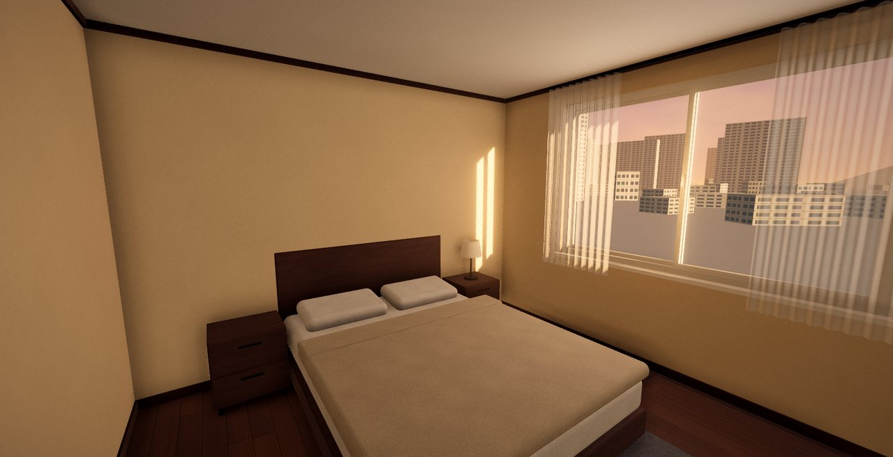
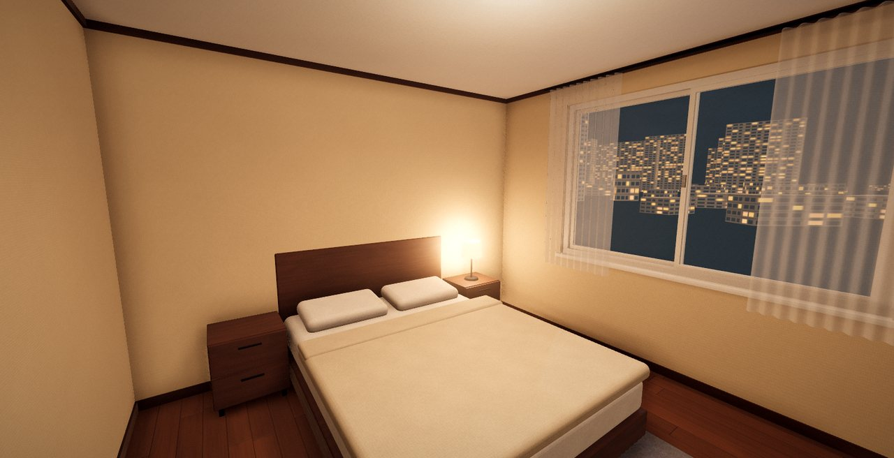
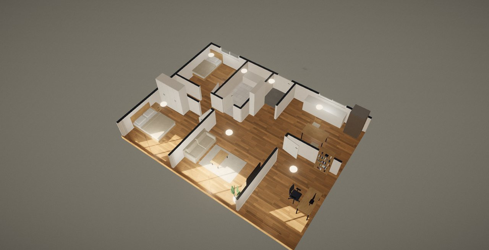
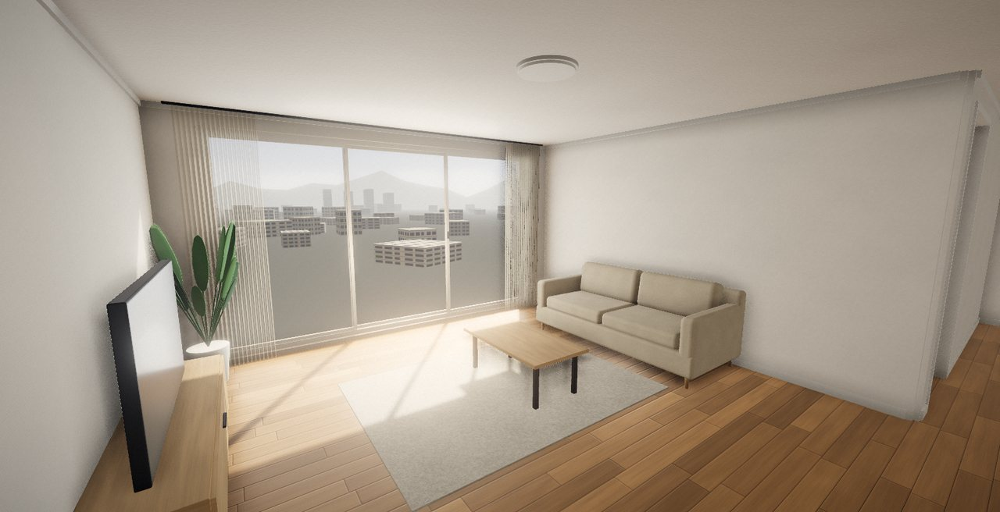

# 방 디자인 프롬프트

방 **설명 글·사진·실측 치수**를 주면, 내 AI가 방 사양 파일을 쓰고 브라우저에 3D 방으로 그려 준다. 그림·3D 모델·텍스처·폰트 파일 없이 **코드만으로** 그린다. API 키, 계정, 서버가 필요 없다(내 PC 안에서만 돈다).

Describe a room (text, photos, rough dimensions, or a floor plan) and your own folder-based AI agent (Claude Code, Codex CLI, Gemini CLI, Cursor…) writes a room spec file that is rendered as a walkable 3D room in the browser. Code only: no image, model, texture or font assets, no API keys, no accounts, no server. Documentation is in Korean.

| | |
|---|---|
|  |  |
|  |  |

## 필요한 것

- [Node.js](https://nodejs.org) 18 이상
- 크롬·엣지 같은 브라우저
- 폴더 안에서 일하는 AI 에이전트 아무거나 하나: Claude Code, Codex CLI, Gemini CLI, Cursor 등. 이 폴더의 `CLAUDE.md` / `AGENTS.md` / `GEMINI.md`(셋 다 같은 내용)를 읽고 따라 한다.

## 시작

0. 받기: `git clone https://github.com/Conan-ccc/room-design-prompt.git` 또는 저장소 페이지의 `Code` → `Download ZIP`으로 받아 푼다.
1. 화면 열기: 윈도우는 `방 열기.bat` 더블클릭, 맥·리눅스는 `방 열기.command` 더블클릭(또는 터미널에서 `node serve.mjs --open`). 예시 방이 열린다.
2. 이 폴더에서 AI 에이전트를 연다.
3. `input/설명.txt`에 방의 **가로·세로 치수**를 쓰고(더 아는 게 있으면 같이), **방 전체가 보이는 사진**을 `input/사진/`에 넣는다. 나머지 값은 AI가 사진을 보고 채우고, 사진으로도 모르는 건 가장 흔한 값으로 넣는다.
4. AI에게 말한다: **"이 설명과 사진으로 방 만들어 줘"**

AI가 `rooms/<이름>/room.json`을 쓰면 화면이 1~2초 안에 다시 그려진다.

## AI에게 할 수 있는 말

- "3×4m쯤 되는 방이야. 문은 왼쪽 끝, 맞은편에 창" (도면 없이 대략만)
- "가로 342cm, 세로 291cm, 천장 230cm로 재 봤어. 고쳐 줘" (실측)
- "이 책상 창가에 놔 줘 https://…" (상품 링크: AI가 페이지에서 이름·치수·색을 읽는다)
- "이 사진 소파, 폭 180cm야. 문 옆 벽에 놔 줘" (제품 사진 + 치수)
- "책상 위에 800루멘 전구색 스탠드 달아 줘", "겨울 오후 3시에 해가 어디까지 드는지 보여 줘"
- "`input/사진`에 넣은 평면도대로 우리 집 전체를 만들어 줘" (집 한 채. 아래 "집 전체")

## 집 전체

방 하나가 아니라 집 한 채도 그린다. 예시는 왼쪽 위 방 이름 → `예시 집`.

- **평면도 그림을 주는 게 가장 정확하다.** 분양 자료나 부동산 앱의 평면도를 캡처해 `input/사진/`에 넣고 "이 평면도대로 집 전체 만들어 줘"라고 한다. 치수선 숫자가 보이는 그림이면 더 좋다.
- 평면도가 없으면 **단지 이름·평형·타입**("○○아파트 84A")을 말해도 된다. 웹 검색이 되는 AI라면 평면도를 찾아서 그리고, 못 찾으면 그 평형의 흔한 구조로 어림해 그린 뒤 어림이라고 알려 준다. 같은 타입도 좌우가 뒤집힌 집이 있으니 결과를 한 번 확인한다. **동·호수는 말할 필요가 없다.**
- 화면에서는 `위에서`로 보면 벽이 허리 높이에서 잘려 집 전체가 보이고, 오른쪽 아래 `방으로 가기`로 방마다 들어간다. 가구·조명은 방 하나일 때와 똑같이 놓고 옮긴다.
- 타워형처럼 윤곽이 들쭉날쭉한 집도 된다(꺾인 면의 창까지 그린다). 실제 방위를 알려 주면 해 드는 방향을 맞춘다("거실 창이 남동향이야").
- 방 사이 벽과 방문은 화면에서 못 고친다. AI에게 말로 시킨다("안방 문을 복도 쪽으로 옮겨 줘").

## 화면에서 직접 하는 것

처음 열면 네 줄짜리 안내가 뜬다(오른쪽 위 `도움말`로 다시 볼 수 있다). 화면 위 가운데에는 지금 할 수 있는 조작이 늘 한 줄로 나온다.

| 무엇 | 어떻게 |
|---|---|
| 둘러보기 | 끌어서 보기, `W A S D`나 바닥 더블클릭으로 걷기. 오른쪽 아래 `위에서`로 방 전체 보기 |
| 햇빛 | 왼쪽 아래 `아침·낮·노을·밤`, 게이지(0~24시), 또는 시각을 직접 적기. 옆의 계절을 누르면 해 높이·방향이 바뀐다 |
| 꾸미기 | 오른쪽 아래 `꾸미기`(또는 `E`) → 오른쪽 패널. 가구·조명을 눌러 고르고 끌어서 옮긴다. 방향키 1cm(Shift 10cm), `R` 돌리기, `Delete` 지우기, `Ctrl+Z` 되돌리기 |
| 가구 | `가구` 탭 → 종류를 골라 `추가`, 치수(cm)와 색·재질 고치기, 돌리기·복제·지우기 |
| 조명 | `조명` 탭 → 천장등·스탠드·전구 추가, 루멘·색온도(K)·색을 적으면 바로 반영. 커튼 걷기 |
| 방 크기·모양 | `방` 탭 → 가로·세로·천장, 문·창 위치와 크기를 cm로 적기. `+ 기둥·꺾인 벽`으로 ㄱ자 방. 마감 분위기와 화면 품질(내장 그래픽이면 낮음이나 보통) |
| 방 바꾸기·새 방 | 왼쪽 위 방 이름 → 다른 방 고르기, 또는 이름과 가로·세로만 적고 `만들기` |
| AI에게 시키기 | `AI로 만들기` 탭의 문장을 복사해 내 AI에게 보내기. AI가 이 방을 고치면 화면이 저절로 바뀌고, 새 방을 만들면 왼쪽 위 방 목록에 뜬다 |
| 단축키 | `E` 꾸미기, `O` 안에서/위에서, `1`~`4` 아침·낮·노을·밤, `H` 글자 숨기기(다시 `H`나 `Esc`) |

화면에서 바꾼 것은 그 방의 `room.json`에 자동 저장된다.

## 알아둘 것

- 조명 밝기는 3000lm 천장등 하나가 작은 방을 보통 밝기로 채우게 맞춘 **상대값**이다. 조도(lux)를 계산하는 정밀 시뮬레이션이 아니다. 해 위치는 서울 근처 값을 어림한 것이다.
- 방은 직사각형에 벽 덩어리(기둥·꺾인 모서리)를 더하는 방식이다. 비스듬한 벽, 둥근 벽, 복층은 안 된다.
- 집 전체는 방 하나보다 그리는 일이 많다. 내장 그래픽에서 움직임이 끊기면 `꾸미기` → `방` 탭 맨 아래 화면 품질을 `낮음`으로 둔다. 빛은 방 사이 벽을 일부 넘어가 보일 수 있다.
- 가구는 정해진 종류를 코드로 그린 모양이다. 실제 제품과 똑같이 생기지는 않고 크기·색·자리를 확인하는 용도다. 목록에 없는 물건은 상자로 나온다.
- 화면에서 고친 것과 AI가 고친 것이 겹치면 **AI가 먼저 고친 내용을 따른다.** 화면에 안내가 뜨고, 방금 화면에서 바꾼 한 가지만 다시 하면 된다. 이때 되돌리기 기록은 비워진다.
- 화면에서 바꾼 시간·계절은 보는 동안만 유지된다. 새로 열면 방 파일에 적힌 시각으로 돌아간다(AI에게 "기본 시각을 저녁 6시로"처럼 말하면 파일에 적힌다).
- 사진과 설명은 **내 AI가 읽는다.** 즉 내가 쓰는 AI 서비스로 전송된다. 이 프로그램 자체는 인터넷으로 아무것도 보내지 않는다.

## 고쳐 쓰기

마음대로 고쳐 써도 된다(MIT 라이선스). 손대기 쉬운 곳:

- 가구 종류·기본 치수·재질·마감 분위기: `src/catalog.js`(목록)와 `src/furniture.js`(모양)
- 방 뼈대(벽·창·문·방 사이 벽): `src/room.js`
- 화면과 조작: `index.html`, `style.css`, `src/main.js`
- AI가 따르는 절차: `CLAUDE.md`(= `AGENTS.md` = `GEMINI.md`, 셋은 같은 내용으로 유지), 사양 규격: `SPEC.md`

고친 뒤에는 `node tools/validate.mjs example-home`과 `node tools/shot.mjs example-home --views overview,start --times noon`으로 예시가 그대로 그려지는지 본다. 내 방(`rooms/` 아래 예시가 아닌 것)과 `input/사진/`은 `.gitignore`로 저장소에 올라가지 않게 해 두었다.

## 라이선스

MIT (`LICENSE`). 함께 들어 있는 Three.js도 MIT다(`vendor/three/LICENSE`).

## 파일

`SPEC.md`(방 사양 규격) · `CLAUDE.md`·`AGENTS.md`·`GEMINI.md`(AI 지침) · `src/`(그리는 코드) · `tools/validate.mjs`(사양 검사) · `tools/shot.mjs`(캡처) · `vendor/three`(Three.js, MIT 라이선스. `vendor/three/LICENSE`) · `docs/`(이 안내문에 쓰는 화면 캡처. 그리는 데는 쓰지 않는다)
